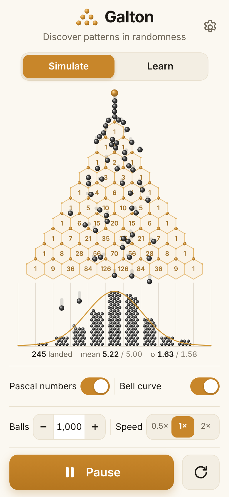
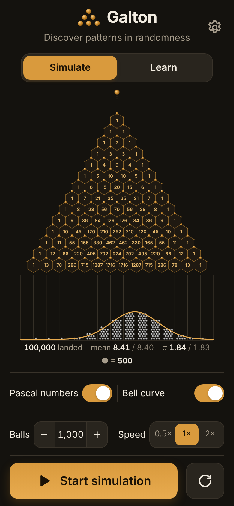
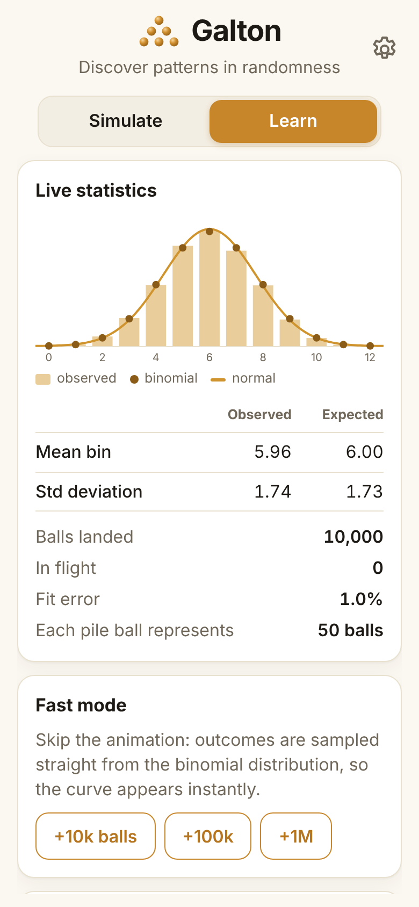
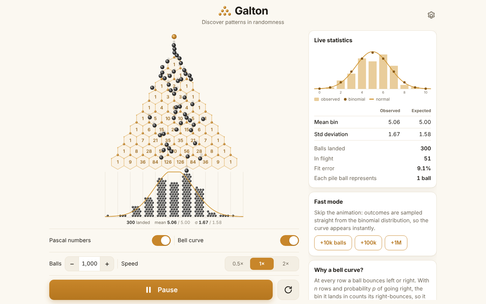
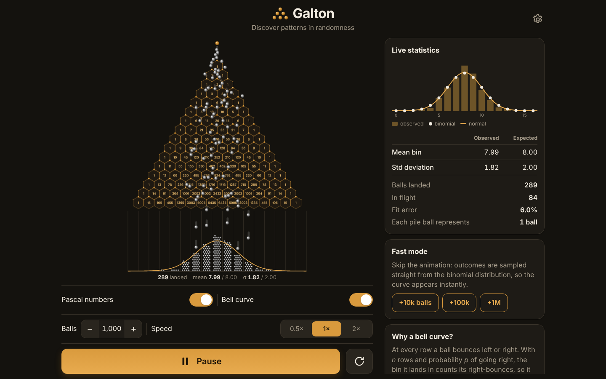

# Galton — an interactive bean machine

[](https://github.com/PavanIT1217/bean-machine/actions/workflows/ci.yml)
[](https://github.com/PavanIT1217/bean-machine/actions/workflows/deploy-pages.yml)

**Discover patterns in randomness.** Balls fall through a honeycomb of pegs labelled with Pascal's
triangle, bounce left or right at every row and pile up into a bell curve. Live demo:
**https://pavanit1217.github.io/bean-machine/**

Built with Vite + TypeScript and the HTML canvas. The physics is hand-written (no physics library),
there is no backend, and the same build ships as a website, an installable PWA, and native
iOS / Android apps via Capacitor.

| Phone (light) | Phone (dark, fast mode) | Learn tab |
| --- | --- | --- |
|  |  |  |




## Features

- **Triangular peg board** with 5–30 rows. Pegs sit at the tips of a honeycomb whose cells show
  Pascal's triangle (how many routes reach each cell); balls travel along the cell edges.
- **Real collisions**: circle–circle impulses with restitution between balls and pegs, balls and balls,
  and balls and bin walls. Balls stack visibly in the bins.
- **Live theory overlay**: the normal curve on the board, plus a histogram with binomial markers.
- **Controls**: ball count, speed (0.5×/1×/2×), Pascal-number and bell-curve toggles, and in ⚙ Settings:
  rows, drop rate, peg bounciness, left/right bias (30–70 %), gravity and theme.
- **Fast mode**: sample 10k / 100k / 1M outcomes straight from the binomial distribution — instant.
- **Statistics**: balls landed, in flight, mean and standard deviation (observed vs expected),
  and the fit error (total variation distance).
- **Responsive & touch friendly**: phone-portrait first, side-by-side panels on desktop, 44 px touch targets,
  safe-area aware, keyboard shortcuts (Space = start/pause, R = reset).
- **Light / dark / auto theme.**
- **Performance**: pooled ball objects, typed-array spatial hash, no per-frame allocation, cached
  backdrop canvas for the board and settled balls, pre-rendered sphere sprites, and an adaptive
  resolution governor. 60 fps with 500+ balls in flight.
- **SEO & PWA**: meta/Open Graph/Twitter tags, JSON-LD, `robots.txt`, `sitemap.xml`, canonical URL,
  `noscript` content, web manifest, offline service worker.
- **Deep links**: `?rows=20&bias=0.6&balls=2000&autoplay=1`.

## Getting started

Requires Node 22+.

```bash
npm install
npm run dev          # http://localhost:5173
npm test             # unit tests (Vitest)
npm run build        # type-check + production build into dist/
npm run preview      # serve dist/
```

### Mobile apps

```bash
npm run android      # build, sync and open Android Studio
npm run ios          # build, sync and open Xcode (macOS)
```

Publishing to Google Play and the App Store is automated by GitHub Actions — see
[docs/MOBILE_RELEASE.md](docs/MOBILE_RELEASE.md) for the one-time account / secrets setup and
[docs/store-listing.md](docs/store-listing.md) for the listing copy.

### Other scripts

| Script | Purpose |
| --- | --- |
| `npm run screenshots` | Regenerate README / manifest screenshots and the OG image (after `npm run build`) |
| `npm run icons` | Regenerate PWA + native icons and splash screens from `public/favicon.svg` |
| `npm run typecheck` | TypeScript only |

## Project structure

```
src/
  core/        config constants, seedable RNG
  physics/     collision.ts (circle collisions), ball.ts (object pool), pile.ts (bin stacking), world.ts (simulation)
  stats/       binomial.ts (pmf, normal pdf, sampling), tally.ts (running counts & moments)
  render/      boardRenderer.ts, histogramRenderer.ts, sprites.ts, palette.ts (theme → canvas colours)
  ui/          controls, tabs, theme, stats panel
  pwa/         service-worker registration
  app.ts       wires everything together and runs the animation loop
tests/         Vitest unit tests (binomial math, collisions, simulation, pool, pile, tally)
public/        static assets: icons, manifest, service worker, robots.txt, sitemap.xml, privacy policy
android/ ios/  Capacitor native projects
scripts/       icon and screenshot generators
docs/          screenshots, mobile release guide, store listing
.github/       CI, GitHub Pages deploy, Google Play and App Store release workflows
```

## How the physics works

The world uses *peg units* (horizontal peg spacing = 1), so the simulation is independent of screen
size; the renderer only scales. Row *r* has *r*+1 pegs at x = k − r/2, rows are √3⁄2 apart — exactly
the centres of a pointy-top hexagonal grid, which is why the Pascal honeycomb lines up with the pegs.

Each 1/240 s substep integrates gravity, resolves ball–ball contacts through a uniform-grid spatial
hash (each pair visited once), then the nearest peg (pegs are farther apart than a ball can reach, so
only one needs checking) and bin walls. Contacts use the classic impulse
`j = −(1+e)·vₙ / (1/mₐ + 1/m_b)` plus positional correction.

To make the **bias** setting meaningful, a ball arriving at each row makes a Bernoulli(*p*) left/right
choice that moves its horizontal *steering target* half a spacing that way, and a damped spring nudges
it there while gravity, bounces and crowding do the rest. Which bin a ball lands in is still decided by
where the physics actually puts it; the test suite checks that crowded drops reproduce the binomial
mean and standard deviation.

Settled balls leave the simulation and are drawn into a hex-packed pile; when a bin would overflow,
each drawn ball starts to represent 2, 5, 10… real balls (shown under the board).

## Deployment

Pushing to `main` runs CI (typecheck, tests, build, Android debug build) and deploys `dist/` to
GitHub Pages. Enable it once under **Settings → Pages → Source: GitHub Actions**.

## License

[MIT](LICENSE)
